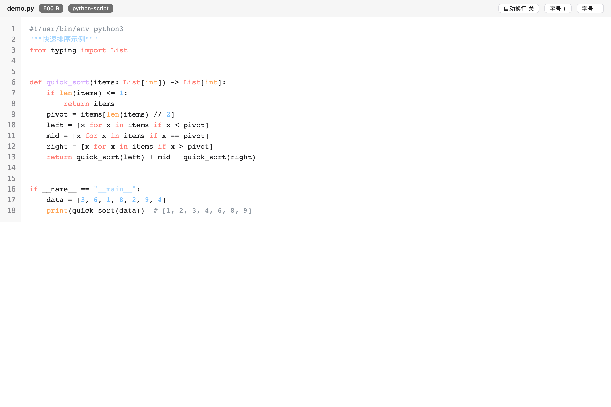
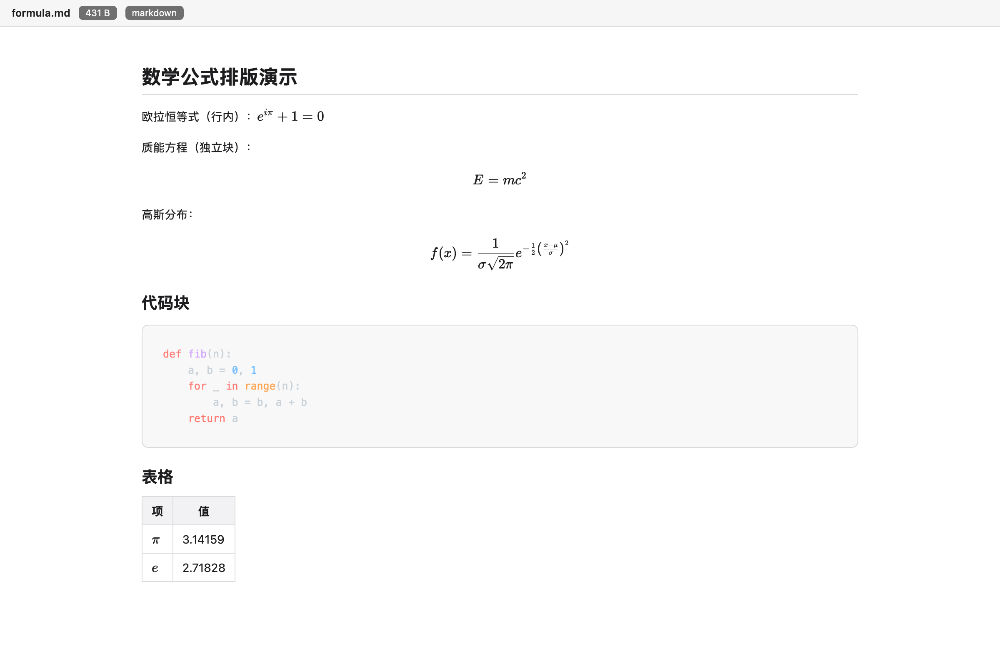
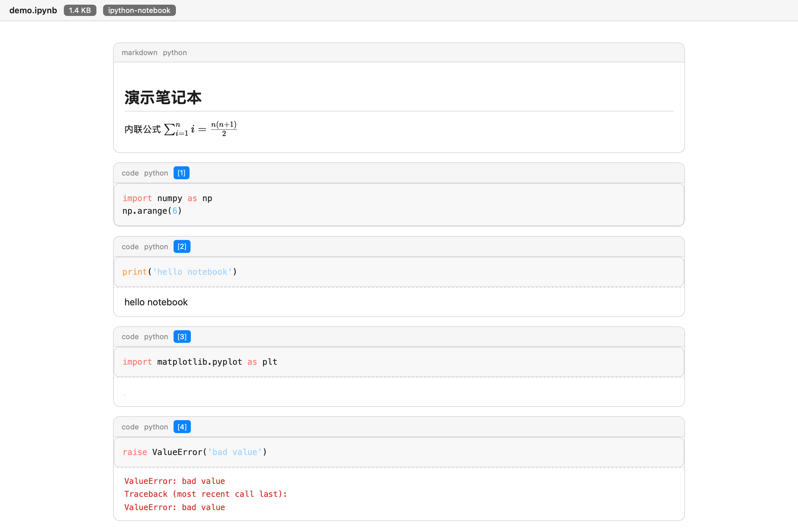
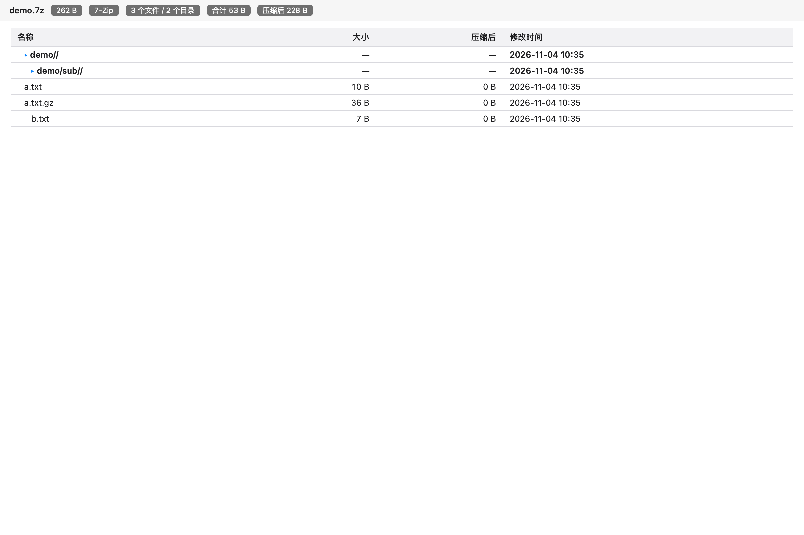
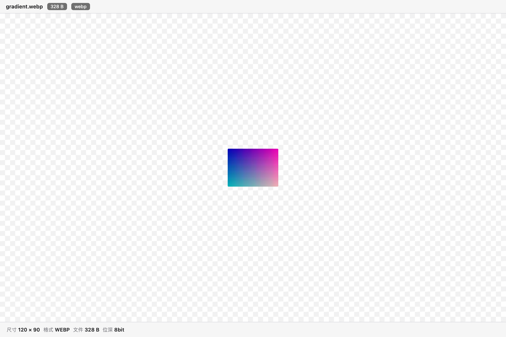
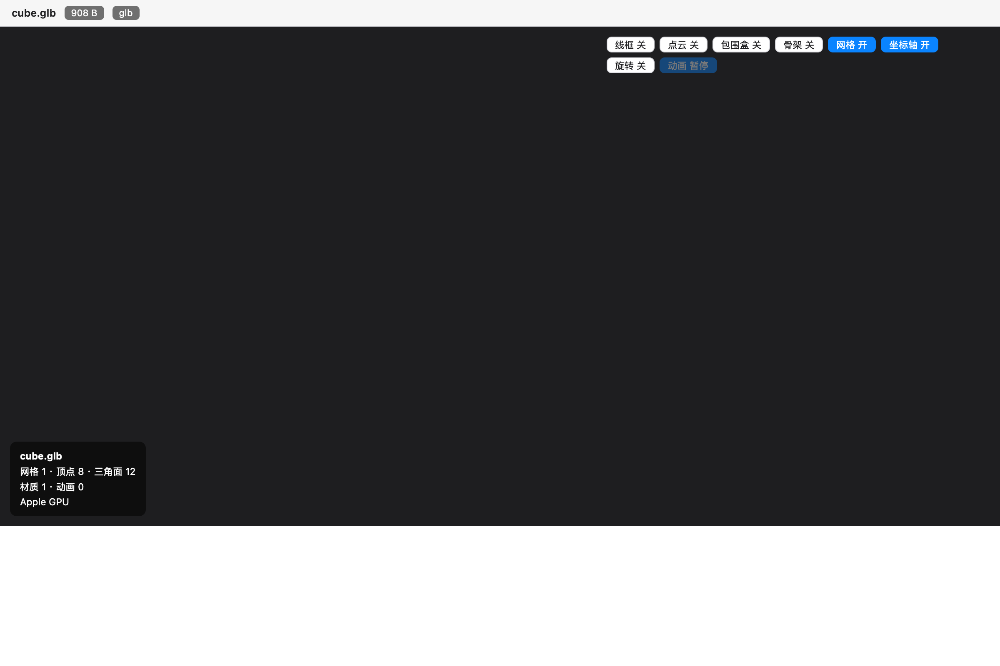
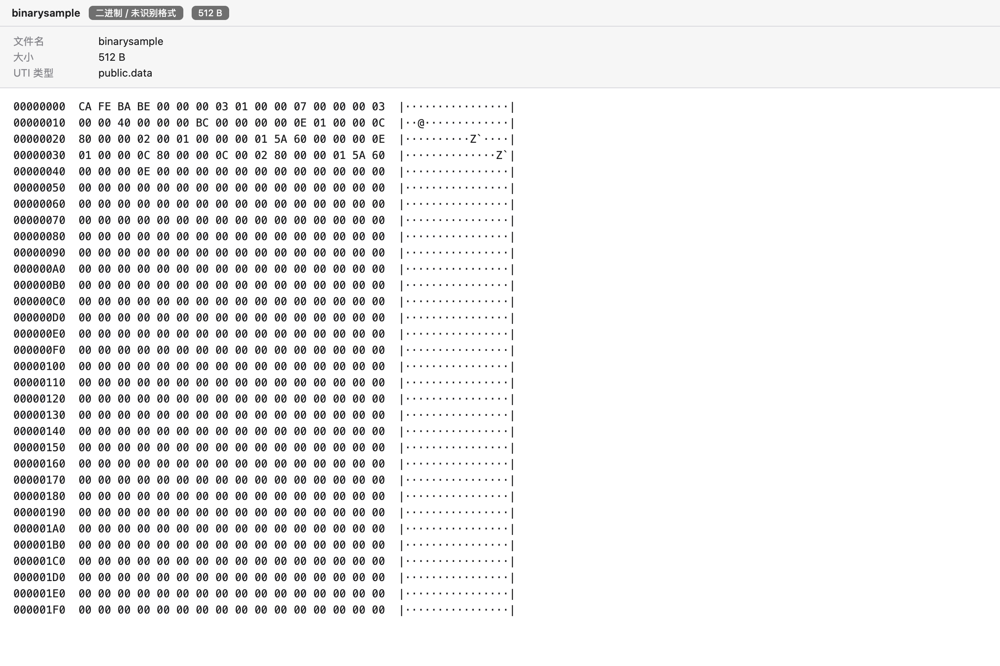

# s-Preview

让 macOS Quick Look 支持并增强更多文件格式的预览插件：源代码语法高亮、Markdown 与 Jupyter 数学公式排版、压缩包内容清单、webp/avif 图片信息、八种三维模型交互渲染，外加未识别文件的兜底预览。



## 功能总览

| 类别 | 格式 | 能力 |
| --- | --- | --- |
| 代码与文本 | 100 多种扩展名 + `README` `Podfile` `Gemfile` `LICENSE` 等特殊文件名 | 语法高亮、行号、九套主题、暗色跟随、字号/制表符/换行 |
| 文档 | Markdown、Jupyter Notebook | GFM 表格、代码块高亮、KaTeX 数学公式、单元格与输出渲染 |
| 压缩包 | zip、tar、tar.gz、7z、rar、gz、bz2、xz | 内容清单、大小/压缩比/时间、目录树、加密标记 |
| 图片 | webp、avif、heic、tiff、bmp | 尺寸、格式、位深、DPI、动图标记 |
| 三维模型 | glb、gltf、obj、stl、ply、dae、fbx、usdz | 交互渲染、实心/线框/点云、包围盒、骨架、动画播放、统计面板 |
| 兜底 | 其余 `public.data` 文件 | 文件信息卡 + 十六进制转储；文本类自动按代码渲染 |

## 界面展示

### 源代码（语法高亮 + 行号）


### Markdown（KaTeX 数学公式 + 表格）



### Jupyter Notebook



### 压缩包清单



### 图片信息条



### 三维模型交互渲染



### 未识别文件兜底



## 预览类别管理

设置页顶部可逐类开关预览：关闭某个类别后，这类文件会交还 macOS 原生预览；macOS 没有原生预览的格式则显示「无预览」。

| 类别 | 关闭后的效果 |
| --- | --- |
| 代码与文本 | macOS 原生纯文本预览 |
| Markdown 与 Jupyter | macOS 原生纯文本预览 |
| 压缩包清单 | 无原生预览，显示「无预览」 |
| 图片信息条 | macOS 原生图片预览（无信息条） |
| 三维模型 | 无原生预览，显示「无预览」 |
| 兜底预览 | macOS 的「无预览」 |

jpg、png、pdf、影片、音乐等格式 macOS 原生预览本来就很完善，s-Preview 从不介入。

## 安装

```bash
./install.sh
```

脚本自动完成构建、签名（ad-hoc）、安装到 `/Applications`、结束旧设置应用并重新注册扩展。若注册声明未立即生效，注销重新登录一次即可。

系统要求：macOS 13+；构建需要 Xcode Command Line Tools 与 Homebrew 的 `libarchive`（压缩包支持）、`webp`（生成图片样本）、`sevenzip`（生成 7z 样本）。

## 设置

打开「s-Preview」应用，保存后新预览立即生效：

- 界面主题（跟随系统/浅色/深色）、代码高亮主题（九套）、字号、制表符宽度、换行、行号
- 数学公式开关
- 压缩包列显示
- 3D 默认项（网格、坐标轴、线框、包围盒、骨架、自动旋转、背景）
- 预览类别逐类开关

## 图标与 Dock 菜单

- 图标由 `Tools/make-icon.swift` 按大苏尔图标网格程序化生成（预览之眼 + `</>` 母题），`iconutil` 编译为 `Resources/AppIcon.icns`，应用与扩展共用
- 重新生成图标：`swiftc -O -o build/tools/make-icon Tools/make-icon.swift && ./build/tools/make-icon build/AppIcon.iconset && iconutil -c icns build/AppIcon.iconset -o Resources/AppIcon.icns`
- Dock 右键菜单：预览主题快捷切换（跟随系统/浅色/深色）、恢复默认设置、打开说明文档
- 关于面板：应用菜单「关于 s-Preview」显示版本与简介

## 架构

```
s-Preview.app
├── MacOS/s-Preview                     SwiftUI 设置应用（类别管理 / 外观 / 3D 选项）
└── PlugIns/s-Preview.QuickLook.appex   Quick Look 预览扩展（视图型，macOS 12+）
    ├── MacOS/s-Preview.QuickLook       扩展二进制（Swift + libarchive）
    ├── Frameworks/                     内嵌 libarchive / liblzma / libzstd / liblz4 / libb2
    └── Resources/Viewer                预览页面（highlight.js / marked / KaTeX / three.js）
```

- 扩展主体是 `NSViewController`，实现 `preparePreviewOfFile(at:)`，按文件类型组装 JSON 载荷注入 WKWebView
- 自定义协议 `spreview-resource://` 同源提供页面资源与目标文件字节流，绕开混合内容拦截
- 关闭的预览类别直接拒绝请求，系统自动回退到原生预览
- 设置存于 `~/Library/Application Support/s-Preview/`（同时写入扩展沙箱映射落点，保证双向可见）

## 目录结构

```
Sources/SPreviewKit        共享逻辑（类型路由、载荷、解析、设置、压缩包）
Sources/QuickLookExtension 预览扩展（控制器、协议处理器）
Sources/SPreviewApp        设置应用（SwiftUI）
Resources/Viewer           预览页面与前端资源
Vendors                    npm 依赖与 esbuild 打包脚本
Tools                      样本生成、图标生成、离屏验证器、测试脚本
docs/screenshots           文档截图（离屏渲染生成）
build.sh / install.sh      构建与安装
```

## 开发与测试

```bash
./Tools/make-samples.sh          # 生成测试样本（代码/文档/压缩包/图片/3D）
./Tools/run-harness-tests.sh     # 无界面回归：28 个样本逐类断言
./Tools/make-demo-folder.sh      # 生成「预览演示」文件夹（Finder 空格键人工验收）
./Tools/make-icon.swift          # 重新生成应用图标
./Tools/run-tests.sh             # 真实 Quick Look 管线批测（弹小窗口，辅助手段）
```

离屏验证器（`Tools/previewharness.swift`）直接驱动真实扩展页面与同一套载荷构建代码，逐类断言渲染结果，不弹任何窗口；加第三个参数可将渲染结果保存为截图（文档截图即由此生成）。

## 已知限制

- `.gltf` 引用外部 `.bin` 或纹理时无法在预览中加载（Quick Look 沙箱只授予被预览文件本身的访问权），建议使用 `.glb`
- `.usdz` 由 three.js 实验性加载器解析，二进制 Crate（.usdc）格式不支持
- 压缩包清单最多显示 5000 条，超出部分会提示；超过 5MB 的文本文件只渲染前 5MB 并提示截断
- 无扩展名文件能否被插件接管取决于系统内容嗅探结果（`Gemfile`、`Podfile` 等归入 `public.data` 的由兜底预览接管）
